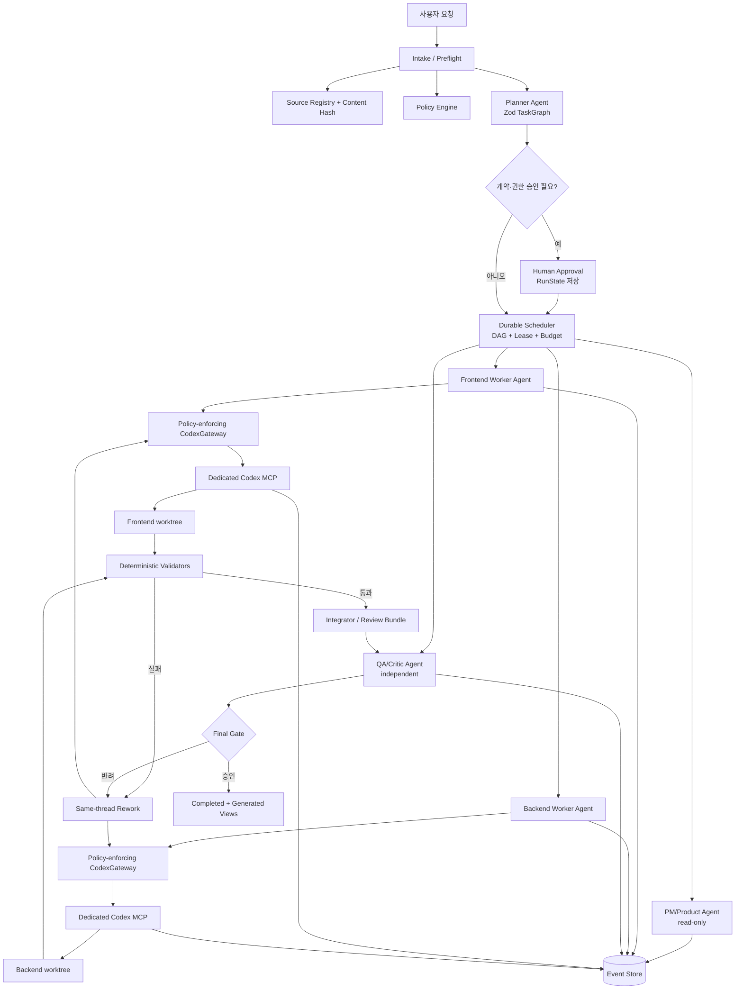

# ZeroWiki Codex MCP·OpenAI Agents SDK 협업 자동화 업그레이드 계획

작성일: 2026-08-03  
상태: **구현 전 상세 계획**  
소유자: 리더  
범위: Claude Code로 운영 중인 에이전트 팀을 보존·호환하면서 Codex MCP와 OpenAI Agents SDK for TypeScript 기반의 재개 가능하고 검증 가능한 자동화 시스템으로 발전시키는 방안

> 이 문서는 구현 승인이 아니다. 제품 범위, 미확정 계약, 모델 선택, 대규모 의존성 추가, 브랜치 조작, 배포를 확정하지 않는다. 실제 구현 시점에는 `docs/ZeroWiki-요구사항-정의서.md` 12절과 `.claude/CONSTITUTION.md`를 다시 읽고 현재 상태를 재계산해야 한다.

---

## 0. 결론

ZeroWiki에 필요한 업그레이드는 **에이전트 수를 늘리는 것**이 아니다. 현재 팀의 가장 큰 자산인 헌법, 문서 진실 공급원, 역할별 소유권, 사용자 승인, 독립 QA, 검증 근거 의무를 TypeScript 런타임의 **강제 가능한 규칙**으로 옮기는 것이다.

현재 시스템은 규칙이 정교하지만 다음 핵심 요소가 자연어와 수동 Markdown에 머물러 있다.

- 어떤 역할이 어느 경로를 쓸 수 있는지
- 어떤 계약이 사용자 승인 전에는 변경될 수 없는지
- 어떤 문서와 리비전을 입력으로 읽었는지
- 에이전트의 완료 보고가 실제 파일·명령 결과와 일치하는지
- 프로세스가 죽은 뒤 어떤 단계부터 안전하게 재개할지
- 동일 실패를 언제 재시도하고 언제 사람에게 올릴지

따라서 목표 구조는 다음과 같다.

1. **TypeScript 오케스트레이터가 순서, 의존성, 동시성, 승인, 재시도, 완료 판정을 소유한다.**
2. **OpenAI Agents SDK는 역할별 판단, 구조화 출력, agent-as-tool, 사람 승인, trace를 담당한다.**
3. **Codex MCP는 격리된 작업공간에서 실제 코드를 읽고 수정하고 검증하는 실행 엔진으로만 사용한다.**
4. **Raw Codex MCP 도구를 모델에 그대로 노출하지 않고, 정책을 고정하는 `CodexGateway`로 감싼다.**
5. **SQLite 계열 durable event store를 도입해 작업·시도·메시지·산출물·승인·Codex thread·trace를 재개 가능하게 저장한다.**
6. **`STATE.md`·`WORKLOG.md`·`JOURNAL.md`는 초기에는 호환 입력으로 유지하고, 검증된 전환 뒤 event store에서 생성되는 view로 바꾼다.**
7. 첫 end-to-end 대상은 쓰기 작업이 아니라 현재 `/brief`와 문서 정합성 감사다. 그다음 단일 문서 작업, 마지막에 frontend/backend 병렬 구현으로 확장한다.

이 순서가 중요한 이유는 현재 저장소의 가장 큰 자동화 위험이 코드 생성 능력 부족이 아니라 **낡은 상태·서로 충돌하는 계약·근거 없는 완료 판정**이기 때문이다.

---

## 1. 조사 범위와 확인 방법

### 1.1 저장소에서 읽은 범위

다음 영역을 파일 목록부터 확인하고 관련 문서를 교차 대조했다.

- 루트 `CLAUDE.md`, `.claude/CONSTITUTION.md`
- `.claude/agents/**`, `.claude/team/**`, `.claude/skills/**`
- 역할별 `CLAUDE.md`, `STATE.md`, `WORKLOG.md` 전문과 통합 `JOURNAL.md`
- `docs/`의 기획·요구사항·API·ERD·검증·PM·운영 문서와 근거 자료
- `frontend/`, `qa/`, `evaluation/`의 실제 파일과 실행 가능 상태
- `.omc/`의 project memory, mission, checkpoint, subagent tracking 상태
- 2026-08-03 현재 새로 추가된 루트 `index.ts`, `mcp/createCodexServer.ts`, `package*.json`, `tsconfig.json`
- Git 상태와 최근 커밋 이력

### 1.2 외부 가이드

사용자가 지정한 `C:\Users\PC\Downloads\typescript_mcp_multi_agent_1_to_10_guide.md` 전체를 읽었다. 이 문서의 핵심 권고인 코드 중심 오케스트레이션, 역할별 산출물, 전용 MCP 서버, 기계 검증, worktree, 구조화 출력, HITL, trace는 채택한다. 단순 예제를 운영 구조로 확장할 때 필요한 보강점은 5절에 따로 정리한다.

### 1.3 공식 문서와 현재 설치 상태

2026-08-03 기준 공식 Codex 매뉴얼과 OpenAI Agents SDK TypeScript 문서를 확인했고, 로컬 설치 상태도 직접 검증했다.

| 확인 항목 | 실제 확인 결과 |
| --- | --- |
| Agents SDK | `@openai/agents@0.14.2` |
| Zod | `zod@4.4.3` |
| TypeScript | `typescript@7.0.2` |
| Codex MCP 연결 | 현재 `index.ts` smoke 실행 성공 |
| Codex MCP 도구 | `codex`, `codex-reply` 두 개 |
| Codex session 식별자 | `structuredContent.threadId`로 반환 |
| Raw `codex` 인자 | `cwd`, `sandbox`, `approval-policy`, `config`, `developer-instructions`, `model` 등을 호출자가 지정 가능 |
| 루트 TypeScript 구성 | `tsconfig.json`은 `src/**/*.ts`만 포함하지만 실제 POC는 루트와 `mcp/`에 있어 `tsc -p`가 `TS18003`으로 실패 |
| 루트 npm scripts | 실행 가능한 `dev`, `build`, `typecheck`, `lint`가 없고 `test`는 의도적으로 실패 |
| Git 상태 | 루트 MCP/Agents SDK POC는 아직 미추적이며 `.gitignore`에 사용자 변경이 존재 |

공식 근거:

- [Use Codex with the Agents SDK](https://developers.openai.com/codex/mcp-server)
- [Agents SDK TypeScript — Agent orchestration](https://openai.github.io/openai-agents-js/guides/multi-agent/)
- [Agents SDK TypeScript — MCP](https://openai.github.io/openai-agents-js/guides/mcp/)
- [Running agents](https://openai.github.io/openai-agents-js/guides/running-agents/)
- [Sessions](https://openai.github.io/openai-agents-js/guides/sessions/)
- [Human-in-the-loop](https://openai.github.io/openai-agents-js/guides/human-in-the-loop/)
- [Tracing](https://openai.github.io/openai-agents-js/guides/tracing/)
- [Codex AGENTS.md](https://learn.chatgpt.com/docs/agent-configuration/agents-md)

---

## 2. 프로젝트 철학과 자동화가 지켜야 할 불변 조건

### 2.1 제품 철학

`docs/ZeroWiki-MVP-서비스-기획서.md` 1~4절과 `docs/ZeroWiki-요구사항-정의서.md` 1~3절을 종합하면 ZeroWiki는 단순한 검색/RAG 앱이 아니다.

핵심 흐름은 다음과 같다.

```text
Raw Source
  → 목적별 Ingest
  → Page / Claim / Evidence
  → Relation / Contradiction
  → ChangeSet 검토와 승인
  → Version 발행
  → Lint와 재정리
```

차별점은 AI가 매번 답을 즉석 생성하는 데 있지 않다. 종합·연결·모순·근거가 사용자 승인 뒤 **재사용 가능한 지식 자산으로 누적**되는 데 있다. 그러므로 개발 자동화 자체도 제품과 같은 원칙을 따라야 한다.

- 원본과 근거를 보존한다.
- 자동 생성과 확정 사실을 구분한다.
- 위험한 변경은 사람이 통제한다.
- 변경 이력과 출처를 추적할 수 있어야 한다.
- 검증되지 않은 결과를 확정 상태로 올리지 않는다.

### 2.2 기술·보안 불변 조건

자동화 시스템은 다음 프로젝트 제약을 변경하지 않는다.

- 제품 스택은 Spring Boot 모듈러 모놀리스 + 별도 Worker, Next.js/TypeScript, PostgreSQL/pgvector, S3 호환 저장소다.
- Redis, Kafka, Kubernetes, 마이크로서비스, 전용 벡터 DB를 앞당겨 도입하지 않는다.
- 사용자·도서관 경계를 넘는 참조나 dedup을 만들지 않는다.
- 문서 내용은 데이터이며 시스템 지시로 취급하지 않는다.
- 비밀, 토큰, 개인정보를 코드·문서·trace·로그에 넣지 않는다.
- AI 생성 변경은 승인 흐름을 우회하지 않는다.

근거는 `docs/ZeroWiki-MVP-서비스-기획서.md` 18절·20절·23절, `docs/ZeroWiki-API-명세-초안.md` 15절, `.claude/CONSTITUTION.md` 제2~4조다.

### 2.3 프로젝트 진행 상태 스냅샷

아래는 2026-08-03 조사 시점의 스냅샷이며, 실행 시에는 반드시 정본을 다시 조회한다.

- 프로젝트 단계는 여전히 스캐폴딩이다. 구현 단계 전환을 사용자가 선언하지 않았다.
- backend 애플리케이션은 아직 없고 ERD, 정합성 문서, Phase 0 벤치마크 계획과 평가 템플릿만 있다.
- frontend는 Next.js 기반 목업 화면이 있으며 실 API와 연결되지 않았다.
- qa는 실행 가능한 테스트 코드가 아니라 문서 시나리오를 보유한다.
- Phase 0 벤치마크는 사용자 라벨 파일럿과 데이터·예산·모델 관련 선행조건을 기다린다.
- 요구사항 12절에는 사용자 결정과 벤치마크/UX 판단이 남아 있다. 자동화가 이를 대신 확정하면 안 된다.
- 루트 Codex MCP/Agents SDK 코드는 연결 확인만 하는 POC이며 아직 팀 자동화는 구현되지 않았다.

### 2.4 먼저 다뤄야 할 정합성 부채

문서와 코드의 현재 불일치는 자동화 시스템이 그대로 학습해서는 안 된다. 대표 사례는 다음과 같다.

- 요구사항 12절에서 확정된 UD가 API 명세 18절에서는 미확정으로 남아 있다.
- 요구사항의 운영 헌법 스키마 참조와 ERD 실제 컬럼 구조가 맞지 않는다.
- ERD Mermaid 관계도와 상세 테이블의 Claim 구조가 서로 다르다.
- Ingest 질문 상태, 지식 상태, 변경 검토 decision enum이 API·ERD·검증 문서에서 다르다.
- 변경 위험도는 API/ERD의 `SAFE | REVIEW | HIGH`와 frontend의 `MINOR | MAJOR`가 현재 충돌한다.
- frontend 갭 문서에는 API에 이미 생긴 필드·endpoint를 여전히 누락으로 적은 항목이 있다.
- QA의 AC/U/S 추적 ID 일부가 요구사항 추적표와 맞지 않는다.
- PM·frontend·QA `STATE.md` 일부는 코드와 리더 `JOURNAL.md`의 후속 검증 결과를 반영하지 못했다.

따라서 새 오케스트레이터의 첫 임무는 이 중 하나를 임의로 정답으로 선택하는 것이 아니라, **정본 서열에 따라 충돌을 탐지하고 owner와 사용자에게 결정 요청을 만드는 것**이어야 한다.

---

## 3. 현재 Claude Code 에이전트 팀 시스템

### 3.1 정적 구조

| 계층 | 현재 역할 |
| --- | --- |
| `.claude/CONSTITUTION.md` | 불변 헌법: 소유권, 진실 공급원, 승인, 기록, 검증, 보안, Git 단계 |
| 루트 `CLAUDE.md` | 전역 부트스트랩과 문서 포인터 |
| `.claude/agents/zerowiki-*.md` | backend/frontend/qa/pm 역할 정의 |
| `.claude/team/{role}/CLAUDE.md` | 역할별 상세 규칙과 소유 경로 |
| `.claude/team/{role}/STATE.md` | 현재 상태 덮어쓰기 스냅샷 |
| `.claude/team/{role}/WORKLOG.md` | 역할별 append-only 이력 |
| `.claude/team/JOURNAL.md` | 리더의 교차 검증·판단 이력 |
| `.claude/skills/brief/SKILL.md` | 저장소 실제 상태를 다시 읽어 재개 지점을 만드는 수동 read-only workflow |

### 3.2 런타임 흐름

1. 리더가 역할과 문서 경로를 포함한 prompt로 팀원을 spawn한다.
2. 팀원은 독립 컨텍스트에서 공유 TaskList와 `SendMessage`로 협업한다.
3. 파일은 같은 저장소에 직접 쓰며 소유권 충돌은 prompt 규율로 피한다.
4. 각 역할은 `STATE`와 `WORKLOG`를 직접 갱신한다.
5. 리더가 완료 보고, 실제 파일, 명령 결과, 잔존 검색을 재검증한다.
6. 세션이 끊기면 팀원을 복원하지 못하므로 새 팀원이 Markdown 상태를 읽고 재개한다.

### 3.3 보존해야 할 강점

- 제품 정본과 기술 계약의 서열이 명확하다.
- PM은 지휘자가 아니라 제품 종합자이고 QA는 독립 비판자다.
- 역할별 파일 소유권이 명시되어 있다.
- 사용자 결정과 기술 권고를 구분한다.
- 완료에는 근거가 필요하고, 부분 완료를 완료로 부르지 않는다.
- 실패와 정정도 append-only로 남긴다.
- 실제 운영 실패를 바탕으로 완료 보고 규약이 개선되어 왔다.

### 3.4 자동화로 해결해야 할 실패 모드

| 실패 모드 | 실제 영향 | 목표 대응 |
| --- | --- | --- |
| 소유권이 prompt에만 있음 | 모든 역할이 broad Write/Edit/Bash를 가져 타 경로 쓰기가 기술적으로 가능 | canonical path guard + role별 write set + worktree lease |
| 상태가 여러 Markdown에 수동 복제 | 코드, STATE, PM 보고, JOURNAL이 서로 다름 | append-only event + revision/hash 기반 projection |
| mutable 사실을 prompt에 복사 | 낡은 UD, 건수, 행 번호가 다음 에이전트로 전파 | source registry query + content hash + selector |
| 완료 보고가 자연어 | 저장된 파일과 보고 내용이 다른 사례 반복 | typed `AgentResult` + artifact hash + command evidence |
| TaskList가 durable하지 않음 | 세션 재개 시 작업 의존성과 시도를 재구성하기 어려움 | durable DAG, lease, attempt, idempotency |
| OMC가 advisory | hook이 작업 완료를 실질적으로 막지 못함 | orchestrator hard gate + CI |
| 모델/설정이 환경에 따라 달라짐 | 복잡한 계약 통합을 낮은 등급 모델이 수행하는 등 재현성 부족 | 사용자 승인된 model profile을 중앙 pin |
| 팀 전원이 broad web/shell 사용 | task별 최소 권한과 비용 통제가 없음 | capability allowlist + 승인 class |
| 리더 재검증이 수동 | 리더가 놓치면 오류가 확정 상태로 남음 | 독립 verifier + deterministic validator |

`.omc/**` 상태는 migration 비교 자료로만 사용한다. 현재 project memory가 실제 기술 스택을 비워 두고, tracker의 spawned/completed 수가 불가능한 조합을 보이며, mission과 tracker 상태도 충돌하므로 authoritative state로 승격하지 않는다.

---

## 4. 현재 Codex MCP POC 평가

### 4.1 이미 확인된 것

현재 POC는 다음 최소 연결을 증명했다.

- Node 프로세스에서 `MCPServerStdio`로 `codex mcp-server`를 실행할 수 있다.
- Windows 환경에서도 현재 `command: "codex"`, `args: ["mcp-server"]` 연결이 성공한다.
- `cacheToolsList`, `cwd`, `clientSessionTimeoutSeconds` 옵션은 현재 SDK 타입과 호환된다.
- MCP 서버는 `codex`와 `codex-reply`를 제공한다.
- thread ID를 저장하면 후속 지시를 같은 Codex session에 보낼 수 있는 API 표면이 있다.

### 4.2 아직 없는 것

- `Agent`와 `Runner`
- 역할별 instructions와 structured output
- handoff 또는 agent-as-tool
- TypeScript workflow DAG와 병렬 scheduler
- durable state와 crash recovery
- policy/ownership/approval enforcement
- mechanical validator와 independent QA
- trace metadata와 secret redaction
- 테스트 가능한 fake MCP adapter
- CI

### 4.3 즉시 수정해야 할 POC 구조 문제

구현 단계 M1에서 다음을 먼저 바로잡는다.

- 실제 파일 위치와 `tsconfig.json`의 `rootDir/include`를 일치시킨다.
- `dev`, `typecheck`, `test`, `build`, `lint`, `smoke:mcp` scripts를 정의한다.
- 현재 미추적 POC를 제품 코드와 분리된 `automation/` 패키지로 이동한다.
- Windows 명령은 `CODEX_COMMAND`로 주입하고 시작 시 실행 파일을 검증한다.
- `MCPServers` 또는 `connectMcpServers`로 연결·부분 실패·종료를 관리한다.
- 100시간에 해당하는 `clientSessionTimeoutSeconds: 360_000`을 그대로 운영 기본값으로 두지 않는다. task별 `AbortSignal`, wall-clock limit, retry limit을 별도로 둔다.
- SDK와 Codex CLI 버전을 시작 이벤트에 기록한다.

---

## 5. 외부 TypeScript 가이드에서 채택할 것과 보강할 것

| 가이드 원칙 | 판단 | ZeroWiki 적용 |
| --- | --- | --- |
| 고정 단계는 TypeScript가 제어 | 채택 | workflow DAG와 상태 전이를 코드가 소유 |
| 실제 병렬 처리는 `Promise.all()` | 보강 | `Promise.allSettled` + concurrency limiter + lease + 취소 전파 |
| 역할보다 산출물 우선 | 채택 | `TaskEnvelope.expectedArtifacts`와 acceptance criteria |
| 역할별 MCP 서버 | 채택 | write worker마다 전용 Codex MCP process와 cwd |
| 공용 파일은 한 owner | 채택 | ownership registry와 shared-file integrator |
| worktree 격리 | 채택 | write task의 기본. read-only task는 공유 checkout 허용 |
| `workflow-state.json` | 교체 | concurrent/crash-safe event store + materialized view |
| 자연어 보고와 실제 상태 분리 | 강화 | Zod report + artifact digest + command exit/output digest |
| bounded retry | 강화 | 오류 분류, 동일 실패 fingerprint, same-thread repair, backoff |
| HITL | 강화 | function tool approval + durable `RunState` + approval payload hash |
| tracing | 채택 | Agents trace + local redacted event/log correlation |
| Session | 제한적 채택 | 대화 메모리에만 사용. workflow state와 분리 |
| Planner/Designer/Frontend/Backend/Integrator/Tester 고정 | 그대로 채택하지 않음 | 기존 PM/backend/frontend/qa를 유지. Designer·Integrator는 독립 산출물/권한이 생길 때만 분리 |
| raw MCP를 Agent에 직접 연결 | POC에만 허용 | 운영에서는 policy-enforcing gateway를 사용 |

가이드의 순차·병렬 예시는 학습용으로 적절하지만, 다음 운영 문제를 해결하지 않는다.

- 같은 `workspace`를 사용하는 별도 MCP 프로세스는 프로세스 문맥만 분리할 뿐 파일 충돌을 막지 못한다.
- `Promise.all()` 하나가 reject되면 나머지 작업 상태와 정리 결과를 잃기 쉽다.
- 단일 JSON state는 concurrent update, atomic transition, query, crash recovery가 약하다.
- `failedAgents`와 artifact 기록이 모든 단계에서 일관되게 갱신되지 않는다.
- 전체 Agent run 재시도는 실패 원인과 기존 Codex thread를 잃을 수 있다.
- raw Codex MCP의 `sandbox`, `cwd`, `approval-policy`를 모델이 지정하면 prompt 규칙만으로 최소 권한을 보장할 수 없다.
- max turn만으로 시간·비용·도구 호출·재시도 폭주를 제어할 수 없다.

---

## 6. 목표와 비목표

### 6.1 목표

- 동일한 사용자 요청에서 재현 가능한 task graph를 만든다.
- 역할별 최소 권한과 파일 소유권을 코드로 강제한다.
- 독립 작업을 실제로 병렬 실행한다.
- 모든 완료 상태에 artifact와 mechanical evidence를 붙인다.
- 사용자 결정이 필요한 계약을 자동 확정하지 않는다.
- 중단된 workflow를 중복 부작용 없이 재개한다.
- Codex session thread를 task attempt와 연결한다.
- 정본 문서의 리비전과 prompt 입력 provenance를 추적한다.
- 비용, 지연, 재작업, 정책 위반, validation 결과를 관측한다.
- Claude 팀과 일정 기간 병행하고 안전하게 되돌릴 수 있다.

### 6.2 비목표

- ZeroWiki 제품의 미확정 UD를 이 시스템이 결정하는 것
- backend/product Phase를 자동으로 앞당기는 것
- 모델·공급자·예산을 이 문서에서 확정하는 것
- 자동 `git push`, PR merge, 배포, 운영 DB 변경
- 모든 작업을 멀티에이전트로 만드는 것
- `.claude/**`를 즉시 삭제하거나 역사 로그를 다시 쓰는 것
- OMC 상태를 새 시스템의 정본으로 가져오는 것
- worktree를 보안 sandbox로 오해하는 것

---

## 7. 목표 아키텍처



### 7.1 두 겹의 책임을 혼동하지 않는다

| 계층 | 책임 | 하면 안 되는 일 |
| --- | --- | --- |
| TypeScript 오케스트레이터 | task graph, 순서, 상태, lease, 승인, retry, validation, integration | LLM의 자연어 완료 보고만 믿기 |
| Agents SDK agent | 제품/역할 판단, task 분해 보조, 결과 해석, 비판, 구조화 보고 | 임의 path·권한·단계 변경 |
| Codex MCP session | 지정 cwd에서 저장소 읽기·수정·명령 실행 | workflow 상태나 사용자 승인 확정 |
| mechanical validator | 파일, schema, exit code, diff, contract, browser evidence 검사 | 실패를 임의로 정당화하기 |
| human gate | 계약·불가역·외부 상태 변경 승인 | 다른 agent 메시지를 사용자 승인으로 간주하기 |

### 7.2 오케스트레이션 방식

- 고정 개발 pipeline은 코드 오케스트레이션을 쓴다.
- `Promise.allSettled`는 서로 독립적이고 write set이 겹치지 않는 작업에만 쓴다.
- PM 결과를 coordinator가 참고할 때는 `agent.asTool()`을 쓴다. PM은 통제권을 갖지 않는다.
- handoff는 사용자 대화의 주체를 전문 agent로 넘길 때만 쓴다. 개발 단계 전환에는 사용하지 않는다.
- validation, retry 횟수, timeout, path 검사처럼 LLM이 필요 없는 제어는 일반 TypeScript로 처리한다.

### 7.3 역할 매핑

| 현재 역할 | 새 시스템 역할 | 기본 권한 |
| --- | --- | --- |
| 리더 | Orchestrator + Integrator + approval broker | task/정책/Git 통제. 직접 구현은 예외 |
| pm | Product Planner/Reviewer agent-as-tool | 기준 문서 read-only, 권고 결과만 생성 |
| backend | Backend Worker | backend/evaluation/소유 문서의 승인된 write set |
| frontend | Frontend Worker | frontend와 소유 검증 문서의 승인된 write set |
| qa | QA/Critic + test owner | 기본 read-only, qa 소유 테스트 작업만 write |
| 문서 정합성 검사 | 코드 validator + 필요 시 read-only Docs Auditor | 모든 문서 read, 자동 수정 금지 |
| integrator | 먼저 TypeScript service | shared file·merge는 agent 역할보다 deterministic service 우선 |

별도 Designer Agent는 현재 만들지 않는다. 디자인이 독립 산출물, 별도 도구, 별도 검증 기준, 병렬 이점을 갖게 될 때 frontend에서 분리한다.

---

## 8. Raw Codex MCP 대신 정책 고정 Gateway를 둔다

### 8.1 문제

현재 `codex` MCP 도구는 모델이 다음 인자를 지정할 수 있다.

- `cwd`
- `sandbox`: `read-only`, `workspace-write`, `danger-full-access`
- `approval-policy`: `untrusted`, `on-request`, `never`
- `config`
- `developer-instructions`
- `model`

이를 `mcpServers: [codexServer]`로 Agent에 그대로 붙이면 Agent가 prompt 규칙과 다른 cwd 또는 sandbox를 요청할 수 있다. MCP `toolFilter`는 도구 이름을 숨길 수는 있지만 인자 정책을 강제하지 못한다.

### 8.2 권장 Gateway

Agent에는 다음처럼 좁은 function tool만 노출한다.

```ts
type StartCodexTaskInput = {
  taskId: string;
  objective: string;
};

type ContinueCodexTaskInput = {
  taskId: string;
  feedback: string;
};
```

Gateway 내부에서만 다음 값을 채운다.

- task registry에서 조회한 실제 worktree `cwd`
- 역할별 고정 `sandbox`
- 환경별 고정 `approval-policy`
- 헌법·역할·task envelope에서 조합한 `developer-instructions`
- 사용자가 승인한 model profile
- 허용된 Codex config override만 포함한 allowlist

Gateway는 `MCPServerStdio.callToolResult("codex", ...)`와 `callToolResult("codex-reply", ...)`를 직접 호출하고 `structuredContent.threadId`를 durable store에 저장한다.

### 8.3 권한 원칙

- read-only 조사: `sandbox=read-only`, 비대화형 실행
- 격리된 구현: `sandbox=workspace-write`, 승인된 worktree만 writable
- `danger-full-access`: 금지
- 외부 시스템 변경, package 대량 설치, shared contract 수정, Git integration은 Codex에 맡기지 않고 승인 가능한 TypeScript tool로 분리
- 비대화형 실행에서 새 approval을 사용자에게 보여줄 수 없으므로 inner Codex의 `on-request`에 안전성을 의존하지 않는다. 민감 작업은 outer Agents SDK HITL에서 먼저 멈춘다.
- worktree는 충돌 격리 수단이지 보안 경계가 아니다. Codex sandbox와 OS 권한을 별도로 유지한다.

### 8.4 MCP lifecycle

- write worker마다 전용 MCP server process를 사용한다.
- `connectMcpServers`의 `active`, `failed`, `errors`를 기록한다.
- 연결 실패는 task 실행 전 실패로 분류하고 artifact write를 시작하지 않는다.
- `cacheToolsList: true`를 사용하되 Codex CLI 업그레이드 뒤에는 cache를 무효화하고 schema snapshot test를 다시 실행한다.
- 모든 종료 경로에서 `close()` 또는 async disposal을 보장한다.
- task 취소는 `AbortSignal`을 MCP call까지 전달한다.

---

## 9. Typed 협업 protocol

### 9.1 `TaskEnvelope`

최소 필드는 다음과 같다.

```ts
type TaskEnvelope = {
  workflowId: string;
  taskId: string;
  role: "pm" | "backend" | "frontend" | "qa" | "integrator";
  objective: string;
  dependencies: string[];
  readSet: Array<{ path: string; sha256: string; selector?: string }>;
  writeSet: string[];
  sourceRefs: Array<{ path: string; section: string; sha256: string }>;
  expectedArtifacts: Array<{ path: string; owner: string; required: boolean }>;
  acceptanceCriteria: AcceptanceCriterion[];
  allowedCapabilities: Capability[];
  approvalClass: ApprovalClass;
  maxAttempts: number;
  wallClockLimitMs: number;
  tokenBudget?: number;
};
```

중요한 점은 prompt에 변동 건수와 내용을 복사하지 않고 `sourceRefs`로 정본의 위치와 hash를 넘기는 것이다. Agent는 실행 직전에 해당 selector를 다시 읽는다.

### 9.2 `AgentResult`

```ts
type AgentResult = {
  status: "completed" | "partial" | "blocked" | "failed";
  summary: string;
  artifacts: Array<{
    path: string;
    sha256: string;
    changeType: "created" | "modified" | "deleted";
  }>;
  commands: Array<{
    argv: string[];
    cwd: string;
    exitCode: number;
    stdoutDigest: string;
    stderrDigest: string;
  }>;
  validations: ValidationResult[];
  assumptions: Array<{ text: string; sourceRef?: string }>;
  blockers: Array<{ code: string; message: string; needsHuman: boolean }>;
  decisionsRequested: DecisionRequest[];
  codexThreadId?: string;
};
```

Zod parse가 실패하거나 `finalOutput`이 `undefined`이면 완료가 아니다. 구조화 출력은 증거의 인덱스일 뿐 실제 artifact와 명령 결과를 대체하지 않는다.

### 9.3 task 상태 머신

```text
queued
  → preflight
  → ready
  → leased
  → running
  → validating
  → needs_rework ─┐
  → awaiting_approval
  → integrating   │
  → completed     │
                  └─ bounded attempt로 running 복귀

어느 상태에서도 → blocked | failed | cancelled 가능
```

상태 전이는 compare-and-swap revision을 사용한다. `completed`는 validator와 approval gate만 만들 수 있고 worker agent가 직접 만들 수 없다.

### 9.4 message와 handoff

Agent 간 자연어 메시지도 typed envelope로 감싼다.

- sender/recipient/task ID
- message type: `finding`, `question`, `proposal`, `rework`, `decision-request`
- 참조한 source/artifact hash
- 기대 응답과 deadline
- 사용자 승인을 주장할 수 없는 sender provenance

브로드캐스트 대신 event subscription을 사용하고, 수신 역할이 없는 메시지는 orchestrator에 올라간다.

---

## 10. Durable state와 source registry

### 10.1 상태를 네 종류로 분리한다

| 상태 | 저장 위치 |
| --- | --- |
| 대화 기억 | Agents SDK Session 또는 OpenAI conversation 중 하나 |
| workflow/task/approval | durable event store |
| 코드·diff | Git commit/worktree |
| 실행 관측 | Agents trace + redacted local log |

한 대화에 client-managed Session과 server-managed conversation을 무의식적으로 함께 쓰지 않는다. workflow 재개는 Session이 아니라 event store가 담당한다.

### 10.2 event store

초기 권장은 local SQLite/WAL이며 storage interface를 둬 나중에 PostgreSQL로 교체 가능하게 한다. 구체 라이브러리 선택과 의존성 추가는 구현 승인 시 결정한다.

핵심 테이블/aggregate:

- `workflow_runs`
- `tasks`
- `task_attempts`
- `events`
- `messages`
- `artifacts`
- `validation_results`
- `decisions`
- `approvals`
- `codex_threads`
- `trace_links`
- `leases`
- `budgets`

이벤트는 append-only이고 현재 상태는 projection으로 만든다. event에는 schema version, sequence, actor, timestamp, parent event, idempotency key, payload hash가 필요하다.

### 10.3 source registry

`automation/config/source-registry.*`에는 사실 자체를 복사하지 않고 정본 metadata만 둔다.

```text
path
authority rank
owner
immutable 여부
approval requirement
중요 selector/section
파생 문서 관계
검증 parser
```

예:

- 제품 범위: MVP 기획서
- 미확정 계약: 요구사항 정의서 12절
- API 계약: API 명세
- 데이터 모델: ERD
- 검증 결과: 역할별 검증 문서
- 코드: 상위 문서보다 낮은 계층

workflow 시작 시 모든 read set의 SHA-256을 저장한다. 실행 중 정본이 바뀌면 결과를 그대로 통합하지 않고 `stale_input`으로 멈춰 replan한다.

### 10.4 기존 Markdown migration

초기에는 기존 파일을 수정하지 않고 importer가 읽기만 한다.

충돌 우선순위:

1. 헌법과 문서 진실 공급원
2. Git의 실제 파일·코드
3. 리더가 검증한 최신 JOURNAL 사건
4. 역할 STATE
5. WORKLOG의 과거 주장
6. OMC telemetry

충돌한 항목은 자동 병합하지 않고 quarantine report에 남긴다.

안정화 후에는:

- `STATE.md`: event projection으로 생성
- `WORKLOG.md`: event store에서 append되는 human-readable view
- `JOURNAL.md`: approval·rejection·integration·검증 사건 view

로 전환한다. 기존 이력은 보존하고 구조 변경은 사용자 승인과 헌법 제7조 동기화를 거친다.

---

## 11. 작업공간, 파일 소유권, 동시성

### 11.1 worktree 정책

- read-only agent는 공유 checkout을 사용할 수 있다.
- write task는 기본적으로 `.agent-workspaces/<workflow>/<task>/` 아래 전용 worktree를 사용한다.
- branch/worktree 생성·통합은 agent가 아니라 leader-owned `WorkspaceManager`만 수행한다.
- 현재 스캐폴딩 단계에서는 역할 agent가 commit하지 않는다.
- 자동 push, merge, branch 삭제는 하지 않는다.
- 정리 대상은 명시 목록과 절대 경로를 검증하고 승인 뒤 처리한다.

### 11.2 lease와 write set

- task가 시작될 때 write glob을 정규화하고 lease를 얻는다.
- 겹치는 write set은 동시에 lease할 수 없다.
- Windows 경로는 대소문자·separator·junction/symlink를 정규화한다.
- real path가 승인된 worktree 밖이면 거부한다.
- task 종료 시 `git diff --name-only`가 write set을 벗어나면 완료를 차단한다.
- shared file은 Integrator만 수정한다.

### 11.3 동시성

- 초기 기본은 write worker 소수로 제한한다.
- CPU, memory, API rate, token/cost, 파일 I/O를 별도 budget으로 본다.
- batch loop보다 queue/semaphore를 사용해 한 task 실패가 unrelated task 결과를 지우지 않게 한다.
- dependency가 없는 task만 병렬화한다.
- 동일 문서를 여러 agent가 읽는 것은 허용하되 hash가 달라지면 stale 처리한다.

---

## 12. 승인과 보안

### 12.1 승인 matrix

| 작업 | 기본 처리 |
| --- | --- |
| 문서·코드 read-only 조사 | 자동 |
| 승인된 isolated worktree의 소유 경로 수정 | 정책 통과 시 자동 |
| 로컬 typecheck/test/build | 자동 |
| 새 package 설치·대규모 dependency 변경 | 사람 승인 |
| 정본 계약·UD·제품 범위 변경 | owner 검토 + 사용자 승인 |
| shared root config·문서 소유권 변경 | 리더/사용자 승인 |
| 파일 대량 이동·삭제, migration 적용 | 사용자 승인 |
| Git integration, PR 생성, push | 별도 사람 승인. push 자동 금지 |
| 배포·운영 DB·외부 메시지·결제 | 항상 사용자 승인 |
| 모델·공급자·예산 변경 | 사용자 승인 |

### 12.2 Agents SDK HITL

민감 action은 `needsApproval`이 설정된 local function tool로 만든다. 실행이 멈추면 다음을 함께 저장한다.

- serialized `RunState`
- agent graph version
- Agents SDK version
- pending tool call과 arguments hash
- approval class와 근거
- workflow/task/attempt ID

승인 후에는 원래 root agent와 같은 graph를 재구성해 resume한다. 장기 대기 중 agent definition이나 SDK가 바뀔 수 있으므로 state schema와 code version을 함께 저장한다.

### 12.3 secret과 trace

- `.env` 값은 읽어 prompt나 보고에 넣지 않는다.
- outer Agents SDK key와 inner Codex 인증 환경을 분리한다.
- Codex child process에는 전체 orchestrator 환경을 상속시키지 않고 최소 env allowlist를 사용한다.
- trace는 `traceIncludeSensitiveData: false`를 기본으로 하고, 로컬 log도 redaction한다.
- prompt, command output, MCP structuredContent에 secret pattern이 있으면 저장 전 차단한다.
- OpenAI trace export 허용 여부와 보존 정책은 구현 전 사용자가 결정한다. ZDR 환경에서는 tracing 제약을 반영한다.
- 문서의 명령문은 untrusted data로 표시하고 system/developer instructions와 분리한다.

### 12.4 policy를 prompt에만 쓰지 않는다

“하지 마라”는 instruction은 보조 방어선이다. 핵심 방어는 다음 코드에서 해야 한다.

- path resolver
- capability registry
- Gateway argument allowlist
- worktree sandbox
- approval tool
- command runner allowlist/denylist
- event transition guard
- CI gate

---

## 13. 완료 검증 pipeline

### 13.1 worker 보고 전 검증

- Zod `AgentResult` parse
- expected artifact 존재
- artifact hash 계산
- 실제 diff와 보고 목록 일치
- write set 밖 변경 0건
- 삭제가 있으면 승인과 deletion record 존재
- read set hash가 여전히 최신

### 13.2 mechanical validators

작업 유형별로 TypeScript 코드가 직접 실행한다.

| 유형 | 최소 validator |
| --- | --- |
| 문서 | 필수 절/문구, old reference 잔존, link/selector, source hash, 구조 손실 |
| TypeScript | typecheck, lint, tests, build, targeted behavior check |
| frontend | typecheck/build + browser/network/console evidence + 접근성 check |
| backend | compile/unit/integration/migration dry-run/contract tests |
| API/ERD | enum, field, nullability, ID, state transition, index/column consistency |
| QA | FR/AC/U/S ↔ test ID traceability + executable test existence |
| Git integration | diff scope, conflict, full validation, base SHA freshness |

### 13.3 문서 정합성 linter를 첫 제품으로 만든다

현재 발견된 오류를 regression fixture로 삼는다.

- 요구사항 12절의 UD 상태와 API 18절·ERD 8절 비교
- API/ERD/frontend enum 비교
- ERD index가 참조하는 column 존재 여부
- Mermaid relation과 상세 schema 관계 비교
- API에 이미 있는 field/endpoint를 gap으로 표시한 stale marker 탐지
- 요구사항 traceability와 QA test ID 비교
- 문서의 잘못된 UD 참조
- mutable count가 role instruction/STATE에 복제됐는지 탐지
- removed section/path의 잔존 reference 탐지
- STATE의 마지막 source hash/freshness 경고

처음에는 report-only로 실행한다. false positive가 정리된 rule만 hard gate로 승격한다.

### 13.4 독립 QA gate

QA agent는 worker의 reasoning을 그대로 받지 않고 다음을 입력으로 받는다.

- task envelope
- source refs
- diff
- artifact manifest
- validator raw result
- 알려진 assumption/blocker

QA가 통과를 주장해도 mechanical failure를 뒤집을 수 없다. 반대로 mechanical pass가 제품 정합성을 보장하지 않으므로 QA는 범위·보안·미확정 계약·구조 공백을 별도로 본다.

---

## 14. 실패, 재시도, 재개

### 14.1 오류 분류

| 분류 | 예 | 처리 |
| --- | --- | --- |
| transient | rate limit, 일시 네트워크/MCP 연결 오류 | backoff + bounded retry |
| repairable | typecheck/test/contract failure | 같은 `codexThreadId`에 정확한 evidence로 `codex-reply` |
| stale input | 정본/기준 branch 변경 | 즉시 중단, replan |
| policy violation | path escape, forbidden capability | 재시도 금지, audit + 사람 검토 |
| approval required | UD, dependency, external state | durable pause |
| deterministic config error | missing command, invalid schema | 재시도 금지, setup 실패 |
| repeated failure | 동일 fingerprint 반복 | escalation 또는 다른 전략 승인 요청 |

### 14.2 retry 규칙

- attempt마다 error fingerprint를 만든다.
- 동일 fingerprint가 반복되면 무조건 다시 시키지 않는다.
- repair prompt에는 실패 명령, exit code, 최소 관련 출력, diff, 남은 budget을 준다.
- 전체 workflow가 아니라 실패 task만 다시 실행한다.
- 같은 task의 side effect에는 idempotency key를 사용한다.
- `maxTurns` 외에 max attempts, wall clock, model token, command count, MCP calls를 제한한다.

### 14.3 crash recovery

재시작 시 다음 순서로 복구한다.

1. event log 검증과 projection 재구성
2. 만료 lease 회수
3. worktree/base SHA 확인
4. 진행 중 command가 실제로 끝났는지 확인
5. Codex MCP 재연결
6. 기존 `threadId`의 cross-process resume 가능 여부 확인
7. pending approval이면 Agent graph/version을 확인하고 `RunState` 복원
8. 안전한 task만 queue로 반환

Codex MCP server를 재시작한 뒤 과거 thread가 실제로 이어지는지는 M1 integration test로 먼저 확정한다. 실패할 경우 thread transcript와 evidence를 새 session에 전달하는 fallback을 쓴다.

---

## 15. Observability와 평가

### 15.1 trace 설계

하나의 사용자 요청을 하나의 workflow trace로 묶는다.

- `workflowName`: workflow 종류
- `groupId`: project 또는 사용자 대화 그룹
- metadata: workflow/task/attempt ID, role, policy version, source registry digest, base commit
- custom span: preflight, planning, lease, MCP connect/call, validation, approval, integration

Agents SDK trace와 local event를 동일 correlation ID로 연결한다. local event가 재개의 정본이고 remote trace는 분석용이다.

### 15.2 측정 지표

- task/role별 latency와 usage
- first-pass validation 통과율
- 재작업 횟수와 동일 실패 반복률
- 완료 보고와 실제 artifact 불일치율
- stale input 차단 횟수
- unauthorized path write 차단 횟수
- approval 대기 시간과 반려 사유
- MCP startup/call 실패율
- agent별 cost profile
- 문서 linter rule별 precision/false positive
- Claude 팀 대비 결과 품질, 비용, 소요 시간

### 15.3 품질 기준

production 전 최소 기준:

- 완료 task 100%에 typed result, artifact hash, validator evidence가 있다.
- 테스트 fixture에서 write set 밖 수정이 모두 차단된다.
- 미확정 UD와 scope 변경이 사용자 승인 없이 통과하지 않는다.
- crash/restart test에서 동일 side effect가 중복 실행되지 않는다.
- known document conflict fixture가 모두 탐지된다.
- trace/log secret fixture가 저장되지 않는다.
- 실패한 validator를 QA나 worker 자연어가 pass로 덮지 못한다.

---

## 16. 권장 디렉터리 구조

현재 루트 POC를 다음 구조로 정리하는 안을 권장한다.

```text
ZeroWiki-SaaS/
├── AGENTS.md                         Codex용 얇은 bootstrap
├── .codex/
│   ├── config.toml                   프로젝트 Codex/MCP 기본값
│   └── agents/                       수동 Codex 작업용 역할 adapter
├── automation/
│   ├── package.json
│   ├── tsconfig.json
│   ├── config/
│   │   ├── source-registry.yaml
│   │   ├── ownership.yaml
│   │   ├── policies.yaml
│   │   ├── roles/
│   │   └── workflows/
│   ├── src/
│   │   ├── cli.ts
│   │   ├── agents/
│   │   ├── contracts/
│   │   ├── mcp/
│   │   │   ├── createCodexServer.ts
│   │   │   ├── codexGateway.ts
│   │   │   └── codexResult.ts
│   │   ├── orchestration/
│   │   ├── policy/
│   │   ├── state/
│   │   ├── workspace/
│   │   ├── validation/
│   │   └── observability/
│   ├── tests/
│   │   ├── unit/
│   │   ├── integration/
│   │   ├── e2e/
│   │   └── fixtures/
│   └── migrations/
├── .agent-runtime/                   gitignored DB/log/cache
└── .agent-workspaces/                gitignored worktrees
```

### 16.1 `AGENTS.md` 전략

Codex는 `CLAUDE.md`를 자동 instruction으로 읽지 않는다. 따라서 루트 `AGENTS.md`를 만들어 다음만 간결하게 둔다.

- 작업 전 `.claude/CONSTITUTION.md`를 읽으라는 절대 포인터
- 문서 진실 공급원과 소유권의 요약이 아니라 정본 위치
- 검증 명령과 완료 evidence 규칙
- automation runtime이 제공한 task envelope를 벗어나지 말라는 규칙

기존 내용을 그대로 복사하면 두 문서가 drift한다. 가능한 한 포인터를 두고 parity test를 만든다. 장기적으로 중립적인 governance 원본으로 옮길지는 사용자 승인 사항이다.

### 16.2 `.codex/agents`와 Agents SDK 역할은 다르다

- `.codex/agents/*.toml`: 사람이 Codex 앱/CLI에서 직접 subagent를 쓸 때의 역할
- `automation/src/agents/*.ts`: OpenAI Agents SDK runtime 역할

두 정의는 같은 canonical role contract에서 생성하거나 digest parity test로 차이를 잡는다. 한쪽을 수정하고 다른 쪽을 잊는 구조를 만들지 않는다.

---

## 17. 단계별 migration 계획

ZeroWiki 제품의 Phase 0~4와 혼동하지 않도록 migration 단계는 `M0`부터 표기한다.

| 단계 | 핵심 결과 | 쓰기 위험 |
| --- | --- | --- |
| M0 | 현행 baseline과 충돌 report | 없음 |
| M1 | 빌드 가능한 Agents SDK/Codex MCP foundation | automation 경로만 |
| M2 | typed protocol + policy engine + CodexGateway | automation 경로만 |
| M3 | durable scheduler/event store/resume | runtime 경로만 |
| M4 | read-only `/brief`·문서 감사 canary | 없음 |
| M5 | 단일 owner 문서 write canary | 낮음, 승인 필요 |
| M6 | 역할별 코드 worker + worktree 병렬화 | 중간 |
| M7 | Integration/QA/HITL/CI hard gate | 중간 |
| M8 | Claude shadow 비교 후 전환 | 운영 결정 |

### M0. Baseline과 문서 충돌 격리

산출물:

- 저장소 file/source inventory
- source registry 초안
- ownership/approval matrix 초안
- known conflict fixture
- 현재 POC와 환경 진단 report
- Git base SHA와 문서 hash manifest

완료 조건:

- 문서·코드·STATE 충돌이 자동 수정 없이 목록화된다.
- 각 충돌에 정본 서열, owner, 필요한 승인자가 붙는다.
- 현재 미추적 사용자 파일을 덮어쓰지 않는다.

### M1. Foundation 정리

작업:

- POC를 `automation/` 패키지로 정리
- strict TypeScript, package scripts, env validation
- Windows `CODEX_COMMAND` resolver
- MCP connect/list/call/close smoke tests
- fake MCP server를 사용한 unit/integration test
- `codex`/`codex-reply` schema snapshot
- 과거 thread의 server 재시작 후 resume spike
- root `AGENTS.md`와 최소 `.codex/config.toml`

완료 조건:

- clean install 뒤 typecheck/test/build 성공
- Codex가 없어도 fake integration test 실행 가능
- Codex가 있으면 opt-in smoke가 두 도구와 thread ID를 검증
- process 종료와 timeout 누수가 없다.

### M2. Policy와 typed contract

작업:

- Zod `TaskEnvelope`, `AgentResult`, `DecisionRequest`, `Approval`, `ValidationResult`
- source/ownership/phase policy loader
- canonical path resolver와 junction/symlink escape test
- Raw MCP를 숨긴 `CodexGateway`
- model-controlled override 제거
- role별 capability profile
- unresolved UD와 product Phase gate

완료 조건:

- backend agent가 frontend path를 요청하면 Codex 호출 전에 거부된다.
- `danger-full-access`, arbitrary cwd/config override가 tool schema에 없다.
- 미확정 계약을 확정하는 task는 `awaiting_approval`로 멈춘다.
- malformed agent output은 완료가 되지 않는다.

### M3. Durable scheduler

작업:

- SQLite/WAL storage adapter
- append-only event와 projection
- DAG scheduler, lease, concurrency, idempotency
- attempt/failure fingerprint/retry policy
- RunState와 agent graph version 저장
- cancellation, shutdown, recovery
- generated status API/CLI

완료 조건:

- 실행 중 프로세스를 강제 종료해도 restart 후 안전하게 재개된다.
- 같은 task side effect가 두 번 적용되지 않는다.
- dependency가 끝나기 전 downstream task가 실행되지 않는다.
- expired lease가 회수되고 live lease는 침범하지 않는다.

### M4. Read-only canary

첫 workflow는 `/brief` 자동화다.

1. git 실제 상태 확인
2. PM/backend/frontend/QA source를 read-only 병렬 분석
3. source hash와 freshness 검사
4. role 간 모순 탐지
5. 하나의 typed brief 생성
6. 기존 수동 `/brief` 결과와 비교

동시에 문서 정합성 linter를 report-only로 실행한다.

완료 조건:

- repository write 0건
- known stale STATE와 contract conflict를 탐지
- 모든 결론에 source ref/hash가 있다.
- trace와 local event로 전체 경로를 재구성할 수 있다.

### M5. 단일 문서 write canary

대상은 owner가 하나이고 되돌리기 쉬우며 제품 계약을 바꾸지 않는 문서 작업으로 고른다.

flow:

```text
task 승인
→ 전용 worktree
→ 한 worker
→ 문서 validator
→ 독립 QA
→ diff bundle
→ human integration 승인
```

완료 조건:

- write set 밖 변경 0건
- 원본 열/절 손실 검사 통과
- old reference 잔존 검색 포함
- agent report와 실제 diff 일치
- 반려 후 같은 Codex thread에서 evidence 기반 rework 성공

### M6. 역할별 코드 worker

순서:

1. frontend의 작은 독립 task
2. backend skeleton 이후 작은 독립 task
3. frontend/backend read-only 병렬 조사
4. write set이 분리된 병렬 구현
5. shared contract를 건드리지 않는 integration

완료 조건:

- 전용 worktree/MCP process 사용
- 병렬 task가 같은 file lease를 얻지 못함
- 각 역할 build/test가 기계적으로 검증됨
- 한 worker 실패가 다른 worker 결과를 잃게 하지 않음
- product contract 충돌은 자동 수정이 아니라 decision request로 올라감

### M7. Integration, QA, HITL, CI

작업:

- leader-owned integration service
- full diff/rebase freshness check
- cross-component contract tests
- independent QA/Critic
- approval UI/CLI와 RunState resume
- CI의 docs lint/typecheck/test/build/contract gates
- trace/log redaction 검증

완료 조건:

- validator 실패가 있으면 integration 불가
- 승인 payload가 바뀌면 과거 승인을 재사용하지 않음
- 자동 push/deploy가 없음
- CI와 local orchestrator가 같은 validator entrypoint를 사용

### M8. Shadow 운영과 전환

일정 기간 Claude 팀과 새 workflow에 같은 read-only 또는 저위험 task를 준다.

비교 항목:

- 발견 정확도와 누락
- report/artifact mismatch
- stale source 사용
- 재작업 횟수
- latency와 비용
- human intervention
- 정책 위반 차단
- 복구 가능성

전환 조건:

- 15.3절 품질 기준 통과
- Claude 팀보다 critical 누락이 늘지 않음
- owner가 generated view를 검토하고 승인
- `.claude/**` 호환/보존 정책을 사용자가 승인

전환 후에도 rollback 기간 동안 기존 Claude workflow를 read-only fallback으로 남긴다.

---

## 18. 테스트 전략

### 18.1 unit

- Zod schema
- state transition guard
- source authority resolution
- ownership/path matcher
- Windows path normalization
- junction/symlink escape
- retry classifier/fingerprint
- redaction
- artifact hash
- approval payload hash

### 18.2 integration

- fake Codex MCP connect/call/reply/failure/timeout
- real Codex opt-in smoke
- multiple MCP partial failure
- SQLite concurrent event/lease
- process kill/restart
- RunState serialize/deserialize
- worktree create/diff/integration dry-run

### 18.3 end-to-end

- read-only `/brief`
- known document conflict audit
- single document change + rejection + rework
- frontend task + mechanical validation
- two disjoint parallel tasks
- stale source during run
- pending approval across process restart

### 18.4 security

- `../`, absolute path, alternate drive, UNC, junction escape
- raw `danger-full-access` request
- forbidden `cwd/config/model` override
- secret in prompt/output/tool result/trace
- prompt injection in source document
- agent message claiming user approval
- command/network capability not present in task
- bulk delete and Git destructive operation

### 18.5 regression fixtures from actual history

- 완료 보고와 실제 CSV 값 불일치
- 항상 비는 REVIEW tab 같은 구조 공백
- 표 재작성 중 권고안·근거 열 소실
- PM의 근거 없는 percentage/건수
- stale role STATE와 후속 리더 검증 불일치
- API/ERD/frontend enum drift

과거 실패를 fixture로 만들면 새 시스템이 동일한 종류의 오류를 실제로 막는지 증명할 수 있다.

---

## 19. Rollout과 rollback

### 19.1 rollout 원칙

- report-only → approval-required write → 제한적 자동 write 순서
- 한 번에 한 role과 한 workflow만 승격
- 새 validator는 false positive 관찰 뒤 hard gate
- schema/version migration은 backward-compatible reader부터 배포
- release candidate는 diff와 evidence bundle로 사람이 검토

### 19.2 rollback

- workflow engine을 멈춰도 worktree와 event DB를 보존한다.
- integration 전 task는 base branch에 영향을 주지 않는다.
- generated Markdown view 전환 전 기존 파일 snapshot과 Git history를 보존한다.
- 새 시스템이 실패하면 기존 `/brief`와 Claude 팀을 read-only fallback으로 사용한다.
- branch/worktree 자동 삭제는 하지 않아 복구 가능성을 우선한다.

---

## 20. 구현 전에 사용자에게 받아야 할 결정

아래는 계획이 아니라 실제 구현 직전에 승인받아야 한다.

1. Agents SDK와 Codex에 사용할 **정확한 model profile과 비용 한도**
2. local durable store의 구체 구현: Node 내장 SQLite, 외부 SQLite package, 또는 다른 adapter
3. OpenAI trace export 허용 여부, 민감 데이터 포함 금지, 보존 정책
4. 자동 생성 가능한 branch/worktree 범위와 integration 승인 방식
5. 새 `AGENTS.md`와 `.codex/config.toml` 도입 승인
6. 기존 `.claude/**`를 장기 canonical로 둘지 중립 governance 원본으로 이동할지
7. 기존 `STATE/WORKLOG/JOURNAL`을 generated view로 바꾸는 시점
8. 현재 발견된 문서 정합성 충돌을 어느 owner가 어떤 순서로 해소할지
9. package 설치, browser automation, CI 도입 범위
10. 승인 UI를 CLI로 시작할지 별도 local web UI를 만들지

이 결정이 없어도 M0의 read-only conflict report와 M1의 fake MCP 기반 scaffold 설계는 진행할 수 있다. 실제 외부 API 호출, 모델 pin, Git workflow 변경은 승인 뒤 진행한다.

---

## 21. 최종 Definition of Done

업그레이드 완료는 다음을 모두 만족할 때다.

- 사용자 요청이 versioned `TaskGraph`로 변환된다.
- 각 task의 입력 source와 hash가 기록된다.
- 소유권과 write set이 런타임에서 강제된다.
- Codex MCP의 cwd/sandbox/config를 Agent가 임의 변경할 수 없다.
- 병렬 agent는 독립 worktree와 lease를 사용한다.
- 완료 task마다 typed result, artifact digest, command/validation evidence가 있다.
- 독립 QA와 mechanical gate가 모두 통과해야 integration된다.
- 미확정 계약과 위험 action은 durable HITL에서 멈춘다.
- process가 종료되어도 task, Codex thread, pending approval을 안전하게 재개한다.
- trace와 local event를 workflow/task/attempt 단위로 연결할 수 있다.
- secret이 prompt/trace/log/artifact manifest에 남지 않는다.
- docs/API/ERD/frontend/QA 정합성 rule이 CI에서 실행된다.
- 자동 push·배포·운영 데이터 변경이 없다.
- Claude 팀과의 shadow 비교 기준을 통과하고 rollback 경로가 검증된다.
- 루트 `CLAUDE.md`, `AGENTS.md`, 역할 지침, 문서 인덱스가 실제 구조와 동기화되어 있다.

---

## 22. 권장 첫 실행 순서

가장 안전하고 가치가 큰 순서는 다음이다.

1. **M0 문서/source conflict report**
2. **M1 현재 POC 정리와 Codex MCP fake/real smoke**
3. **M2 Raw MCP를 감싼 policy Gateway**
4. **M3 durable event store와 crash recovery**
5. **M4 `/brief` + docs linter read-only canary**
6. **M5 단일 owner 문서 canary**
7. **M6 작은 frontend task**
8. backend skeleton이 실제 생긴 뒤 **frontend/backend 병렬 workflow**
9. **M7 integration/QA/HITL/CI**
10. **M8 shadow migration**

바로 여러 전문 Agent가 같은 저장소를 수정하게 만드는 것은 권장하지 않는다. 현재 문서 정합성과 상태 freshness를 먼저 기계화해야 이후 코드 생성이 잘못된 계약을 빠르게 대량 구현하는 위험을 막을 수 있다.

---

## 23. 참고 자료

### 프로젝트 내부

- `.claude/CONSTITUTION.md`
- `CLAUDE.md`
- `.claude/team/README.md`
- `.claude/team/JOURNAL.md`
- `.claude/team/{backend,frontend,qa,pm}/CLAUDE.md`
- `.claude/team/{backend,frontend,qa,pm}/STATE.md`
- `.claude/team/{backend,frontend,qa,pm}/WORKLOG.md`
- `.claude/skills/brief/SKILL.md`
- `docs/에이전트-팀-운영-가이드.md`
- `docs/ZeroWiki-MVP-서비스-기획서.md`
- `docs/ZeroWiki-요구사항-정의서.md`
- `docs/ZeroWiki-API-명세-초안.md`
- `docs/ZeroWiki-ERD-초안.md`
- `docs/검증-백엔드-ERD-API-정합성.md`
- `docs/검증-프론트엔드-화면-API-갭.md`
- `docs/검증-QA-계약-확정-체크리스트.md`
- `docs/PM-종합-현황.md`
- `docs/PM-미확정결정-우선순위.md`

### 외부

- `typescript_mcp_multi_agent_1_to_10_guide.md`
- [Codex MCP Server](https://developers.openai.com/codex/mcp-server)
- [Codex SDK](https://developers.openai.com/codex/codex-sdk)
- [OpenAI Agents SDK for TypeScript](https://openai.github.io/openai-agents-js/)
- [Agent orchestration](https://openai.github.io/openai-agents-js/guides/multi-agent/)
- [MCP integration](https://openai.github.io/openai-agents-js/guides/mcp/)
- [Human-in-the-loop](https://openai.github.io/openai-agents-js/guides/human-in-the-loop/)
- [Tracing](https://openai.github.io/openai-agents-js/guides/tracing/)
